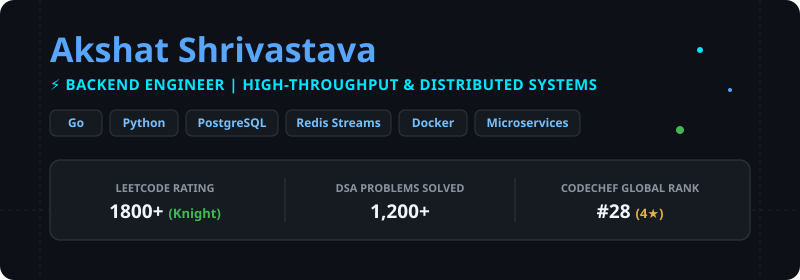
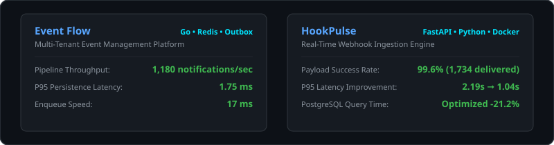

# Akshat Shrivastava — GitHub Profile

  

## 🚀 About Me
Backend Engineer passionate about building **high-throughput microservices**, **event-driven architectures**, and **scalable REST APIs**. Graduating in B.E. ECE from **Thapar Institute of Engineering and Technology** (2022–2026).

- 🛠️ Currently building distributed backend systems with **Go**, **FastAPI**, **Redis**, and **PostgreSQL**.
- 💡 Strong focus on concurrency, event streaming (Redis Streams, Outbox Pattern), and system observability with **Prometheus** & **Grafana**.
- 🚁 Hands-on hardware engineering experience with **Autonomous Drones** & **3D Printer customization**.
- 🏆 Competitive Programmer: **LeetCode Knight** (1800+ rating, top 5% India) with 1,200+ problems solved.

---

  

---

  

---

## 📌 Featured Work

### 🔷 Event Flow | *Go, Gin, PostgreSQL, Redis, Docker, Azure, Prometheus, Grafana*
> Multi-Tenant Event Management Platform engineered for low-latency notifications and concurrent queue handling.
- Optimized Go notification pipelines with **Redis Streams** and **PostgreSQL outbox pattern**, achieving **1,180 notifications/sec** with **1.75 ms P95 persistence latency**.
- Built waitlist promotion engine handling 10 concurrent upgrades on registration cancellations.
- Configured observability metrics via Prometheus & Grafana, achieving zero HTTP failures across load tests.

### 🔷 HookPulse | *FastAPI, Python, PostgreSQL, Docker, Prometheus, Grafana*
> High-throughput real-time webhook ingestion engine.
- Delivered **1,734 webhook payloads at a 99.6% success rate** using async worker pools with exponential backoff retries.
- Reduced P95 response latency from **2.19s to 1.04s** and boosted throughput to 2.16 RPS.
- Optimized DB performance by **21.2%** with connection pooling and query refactoring.

---

## 💼 Work Experience

### **Hardware Engineer Intern** — *autoAbode Electronics Consumer Pvt. Ltd.*
*(Mar 2026 – Jul 2026)*
- Designed autonomous drones for obstacle detection and route planning in agriculture, surveillance, and rescue.
- Configured flight controllers, GPS modules, and cameras for autonomous navigation and real-time communication.
- Built and customized 3D printing machines across multiple build volumes with custom motherboard variants.

---

## 📫 Connect with Me
- **Email:** sshrivastava.akshatt@gmail.com
- **LinkedIn:** [Akshat Shrivastava](https://linkedin.com)
- **LeetCode:** [LeetCode Knight Profile](https://leetcode.com)
- **CodeChef:** 4-Star Coder (Global Rank #28)
